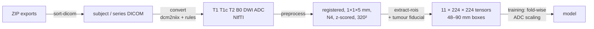

# HN-MRI-Preprocessing

**Leak-free DICOM-to-tensor preprocessing for multiparametric head-and-neck MRI**, developed
for deep-learning classification of parotid gland tumours (MD thesis, 2026; manuscript in preparation).

[](https://github.com/skasrap/HN-MRI-Preprocessing/actions)


Head-and-neck MRI is hard to standardise. Protocols name the same sequence a dozen different
ways, structural images are thick 2D stacks (median 0.44 × 0.44 × **5.0** mm in this cohort, an
11:1 anisotropy), and diffusion EPI comes on a different grid (1.0 × 1.0 × 3.85 mm) with its own
geometric distortion. Most open pipelines target brain MRI, which is near-isotropic and
skull-stripped. This repository turns raw vendor exports into aligned, normalised, fixed-size
tensors of **T1, T1c, T2, low-b DWI, high-b DWI and ADC**. Every decision is configurable,
logged and tested.

**Scope.** Stages 1–3 (sorting, conversion, registration, normalisation) are generic for
head-and-neck multiparametric MRI. Only stage 4 is task-specific: it extracts fixed-size boxes
(48–90 mm, chosen for parotid lesions) around a tumour fiducial, and the box sizes, depth and
sequences are all configurable.



## Highlights

- **Anisotropy-aware throughout.** Per-axis anti-aliasing that never blurs the slice axis, morphology
  in millimetres with a one-slice through-plane radius, and slice windows that respect where the EPI
  slab actually has data.
- **One interpolation per image.** B0 → T2 (affine) and T2 → T1c (rigid) are composed, and DWI/ADC
  reuse the B0 transform.
- **Leakage-safe ADC.** ADC stays in physical units (harmonised to 10⁻⁶ mm²/s) until training.
  `FoldwiseADCScaler` fits on each fold's training subjects and *raises* if it is applied to a
  subject it was fitted on ([docs/data_leakage.md](docs/data_leakage.md)).
- **Reproducible.** Seeded registration (bit-identical with `num_threads: 1`), a typed YAML
  config, and per-subject `provenance.json` (config hash, git commit, library versions) with
  saved transforms.
- **Auditable.** Every series classification, selection and failure is written to a CSV, ready for
  a STARD flow diagram. QC figures are produced for every subject.
- **Tested without patient data.** A synthetic phantom sampled on realistic anisotropic grids drives
  ~85 tests, including end-to-end checks that the fiducial still hits the tumour after registration.

## Install

```bash
git clone https://github.com/skasrap/HN-MRI-Preprocessing && cd HN-MRI-Preprocessing
python -m venv .venv && source .venv/bin/activate
pip install -e ".[dev]"
pre-commit install            # strips notebook outputs, blocks imaging files
```

Stage 2 needs [dcm2niix](https://github.com/rordenlab/dcm2niix) on `PATH`.

## Usage

```bash
# 1. Unpack exports; pseudonymise subjects, keep the key outside the repo
hn-mri-prep sort-dicom  exports/ data/dicom --pseudonymize PG --id-map ~/private/key.csv

# (optional) dry run of the sequence classifier: what changes vs the thesis rules?
hn-mri-prep classify    data/dicom --out series_classification.csv

# 2. DICOM -> T1/T1c/T2/B0/DWI/ADC per subject
hn-mri-prep convert     data/dicom data/nifti --temp-dir data/tmp --config configs/recommended.yaml

# Acquisition statistics for the manuscript
hn-mri-prep audit-spacing data/nifti reports/spacing

# 3. Register, resample, normalise, crop
hn-mri-prep preprocess  data/nifti data/preprocessed --config configs/recommended.yaml --workers 4

# 4. Place a fiducial on the tumour in 3D Slicer (saved as <subject>/F.mrk.json), then:
hn-mri-prep extract-rois data/preprocessed data/tensors --config configs/recommended.yaml
```

Outputs: `data/tensors/{48mm,64mm,80mm,90mm,Whole_3Slice}/<subject>_<seq>.npy` (float32,
`[slice, row, col]`, radiological orientation), plus `roi_manifest.csv` and QC sheets.

## Configurations

| File | Purpose |
|---|---|
| [`configs/recommended.yaml`](configs/recommended.yaml) | Package defaults. Use for new runs and the manuscript. |
| [`configs/thesis_v5.yaml`](configs/thesis_v5.yaml) | Reproduces the thesis pipeline; every post-thesis fix is switched off. |

The differences, and why each exists, are in [docs/code_review.md](docs/code_review.md).

## Repository layout

```
src/hn_mri_prep/
  io/              dicom_sort · series_classifier · nifti_convert       (stages 1–2)
  preprocessing/   geometry · registration · masks · intensity · cropping · qc · pipeline  (stage 3)
  roi/             fiducials · extraction · qc                           (stage 4)
  normalization/   adc  (fold-wise ADC scaling, leakage checks)
  audit/           spacing
  config.py · provenance.py · cli.py
configs/   tests/   docs/
```

## Documentation

- [Methods text and parameter table for the manuscript](docs/methods_preprocessing.md)
- [Data-leakage analysis, step by step](docs/data_leakage.md)
- [Code review of the thesis pipeline: findings and fixes](docs/code_review.md)

## Data and privacy

No images, tensors or patient identifiers are part of this repository. The `.gitignore` and the
pre-commit hooks block DICOM/NIfTI/NumPy files, manifests and re-identification keys. Data
sharing is subject to [ethics approval / data-use agreement: fill in].

## Roadmap

- [x] Preprocessing pipeline (this release)
- [ ] Training and cross-validation (patient-grouped, stratified, nested for model selection)
- [ ] Evaluation and STARD-compliant reporting (ROC/AUC with CIs, calibration, decision curves)
- [ ] Interpretability (saliency on the ADC / T1c channels)

## Citation

See [`CITATION.cff`](CITATION.cff). Manuscript reference to follow.

*Research software, not a medical device. Not for clinical use.*
